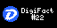

# DigiFacts for Tronbyt

Shows a DigiFact - a bite-size fact about DigiByte - on your [Tronbyt](https://github.com/tronbyt) (or Tidbyt) display. The DigiByte logo and the DigiFact's number are shown first, then they scroll up off the display with the DigiFact following (on square 64x64 displays, the DigiFact scrolls up under a header). If the DigiFact has a link, a QR code for it is shown at the end - scan it with your phone to learn more. It plays in full, however long the DigiFact is.



Works on every display: 64x32, 64x64 and 128x64.

## Settings

- **Language:** English, Deutsch, Español, Français, Italiano, Nederlands, Português or Русский. (Chinese, Hindi, Japanese and Korean DigiFacts can't be shown yet - the display fonts don't have those characters.)
- **Text size:** small, medium or large.
- **Show:** the DigiFact of the day (the same for everyone, changing at midnight UTC), or a random DigiFact each time.

The DigiFacts come from [digifacts.diginode.tools](https://digifacts.diginode.tools/help/) and are checked at most once an hour.

## Developing

```sh
pixlet serve tronbyt/digifacts/digifacts.star            # Live preview
pixlet render tronbyt/digifacts/digifacts.star -2         # Render at 128x64
pixlet check tronbyt/digifacts/digifacts.star             # Lint and checks, as the Tronbyt apps repo does
```

This copy is the source. To publish a new version, copy this folder to `apps/digifacts/` in a fork of [tronbyt/apps](https://github.com/tronbyt/apps) and open a pull request.
